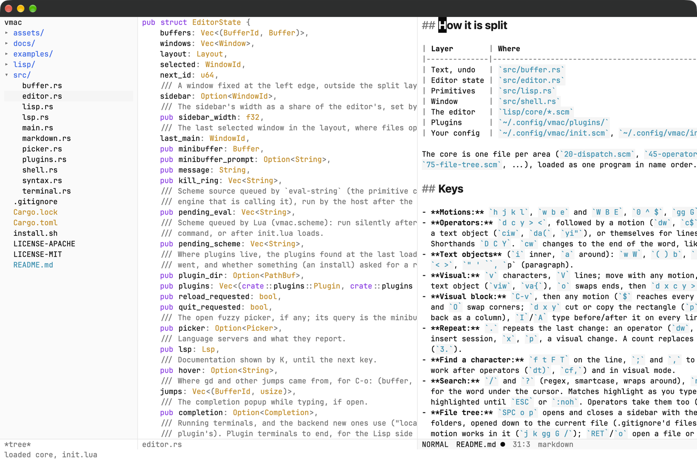

<p align="center"></p>

<p align="center">A modal (evil-style) editor on GPUI whose behavior is written in Lua,
and can be redefined while it runs.</p>

<p align="center"><a href="https://super-yojan.dev/vmac/">Install and configure</a></p>

<p align="center">
  <picture>
    <source media="(prefers-color-scheme: dark)" srcset="assets/screenshot-dark.png">
    
  </picture>
</p>

vmac was called gmacs. Plugins that use `gmacs.*` in Lua still work (it's an
alias of `vmac`), and `~/.config/gmacs/` is read while `~/.config/vmac/`
doesn't exist; move it there when you like.

## Install

vmac builds from source with Rust's cargo (get it from [rustup.rs](https://rustup.rs)).
It's tested on macOS; each release also comes built, for macOS, Linux and Windows.

```sh
curl -fsSL https://raw.githubusercontent.com/Super-Yojan/vmac/master/install.sh | sh
```

or, the same thing by hand:

```sh
cargo install --git https://github.com/Super-Yojan/vmac --tag v0.0.9 --locked
```

Then `vmac FILE`. Your config goes in `~/.config/vmac/` (`init.lua`,
`plugins/`). From a checkout, `cargo run -- FILE` runs it with live reload
of `lua/core/`.

**Built,** each [release](https://github.com/Super-Yojan/vmac/releases)
has vmac with its window:

- macOS 13 or later (Apple silicon and Intel): `vmac-macos-universal.zip`,
  with `vmac.app`. Move it to `/Applications`. It isn't notarized, so the
  first time, clear the quarantine macOS puts on downloads:
  `xattr -dr com.apple.quarantine /Applications/vmac.app`.
  For the `vmac` command too, link it: `ln -s /Applications/vmac.app/Contents/MacOS/vmac-bin ~/.local/bin/vmac`.
- Linux (x86_64 and arm64, glibc 2.35 or later): `vmac-<arch>-unknown-linux-gnu.tar.gz`.
  Unpack it into `~/.local` (or `/usr/local`) for the `vmac` command and a
  menu entry: `tar -xzf vmac-x86_64-unknown-linux-gnu.tar.gz --strip-components=1 -C ~/.local`.
  It needs Vulkan drivers, and Wayland or X11.
- Windows 10 or later (x86_64): `vmac-x86_64-pc-windows-msvc.zip`, with
  `vmac.exe`. Put it on your `PATH`, or open it from Explorer. Windows is
  new: commands that run shell scripts expect a Unix shell (Git Bash, WSL).

**As a Mac app, from source.** From a checkout, `scripts/make-app.sh` builds `vmac.app`
into `/Applications` (or the folder you name), with its icon, so it opens
from Spotlight, Launchpad and the Dock. Opened that way it starts on the
dashboard, in your home folder, with your login shell's `PATH` (so it finds
language servers, fish, `npx` and the agents). It needs `rsvg-convert` and
ImageMagick (`brew install librsvg imagemagick`). Run it again after
updating to rebuild the app.

## Updating

vmac checks for a new release once a day (in the window) and says when one
is out; it never downloads one you didn't ask for. `SPC h u`, `:update` or
`vmac update` installs it: the release's file for your system, checked
against the release's `SHA256SUMS`, moved in place of the old one (the Mac
app, a Linux release unpacked into a prefix, or `vmac.exe`). A vmac built
with `cargo install` is rebuilt with cargo (in a terminal, from inside
vmac). `vmac update --check` and `:update-check` only check; `vmac
--version` says which vmac this is.

Once a newer vmac is installed (by vmac or by hand), the vmac running waits
until a restart would lose nothing (no unsaved files, no agent at work, no
command running in a terminal; the modeline shows `↻ VERSION` meanwhile),
then asks whether to restart onto it. Yes reopens your sessions, with their
projects and files. No leaves it: `:restart-server` asks again, and
`:restart-server!` restarts even with something unsaved or running. A
server on another machine (`vmac connect`) is offered the same when a newer
vmac connects to it, and restarts onto the build that vmac installs there.

`vmac.set_update_check(false)` in `init.lua`, or `VMAC_NO_UPDATE=1`, turns
the daily check off. Builds from a checkout never check.

## How it is split

| Layer        | Where                                                | What                                                                           |
|--------------|------------------------------------------------------|--------------------------------------------------------------------------------|
| Text, undo   | `src/buffer.rs`                                      | a rope, the point, undo snapshots                                              |
| Editor state | `src/editor.rs`                                      | buffers, windows and splits, LSP, the picker                                   |
| Primitives   | `src/lisp.rs`                                        | `vmac.insert`, `vmac.char_at`, `vmac.delete_region`, `vmac.find_file`, ...     |
| Sessions     | `src/session.rs`, `src/server.rs`, `src/daemon.rs`   | lay out frames from keys; sessions; the server windows attach to               |
| Window       | `src/shell.rs`                                       | draws frames: windows, modelines, popups; sends every key to the session       |
| The editor   | `lua/core/*.lua`                                     | states, motions, operators, keymaps, picker, file tree, LSP commands, modeline |
| Plugins      | `~/.config/vmac/plugins/`                            | Lua, loaded after the core                                                     |
| Your config  | `~/.config/vmac/init.lua`                            | loaded last                                                                    |

The core is one file per area (`00-core.lua` for the key dispatcher and
keymaps, `10-motions.lua`, `20-editing.lua`, `40-tree.lua`, ...), loaded in
name order. Its state and functions are in the global `core` table.

## Keys

- **Motions:** `h j k l`, `w b e` and `W B E`, `0 ^ $`, `gg G`, with counts (`3j`; `5G` and `5gg` go to line 5).
- **Operators:** `d c y > <`, followed by a motion (`dw`, `c$`, `y2j`, `dG`),
  a text object (`ciw`, `da(`, `yi"`), or themselves for lines (`dd`, `3yy`, `>>`).
  Shorthands `D C Y`. `cw` changes to the end of the word, like Vim.
- **Text objects** (`i` inner, `a` around): `w W`, `( ) b`, `[ ]`, `{ } B`,
  `< >`, `" ' ``, `p` (paragraph).
- **Visual:** `v` characters, `V` lines; move with any motion, select with a
  text object (`viw`, `va{`), `o` swaps ends, then `d x c y > < p`; `ESC` leaves.
- **Visual block:** `C-v`, then any motion (`$` reaches every line's end), `o`
  and `O` swap corners; `d x y` cut or copy the rectangle (`p`/`P` paste it
  back as a column), `I`/`A` type before/after it on every line, `c` changes it.
- **Repeat:** `.` repeats the last change: an operator (`dw`, `ci"foo`), an
  insert session, `x`, `p`, a visual change. A count replaces the original
  (`3.`).
- **Find a character:** `f t F T` on the line, `;` and `,` to repeat; they
  work after operators (`dt)`, `cf,`) and in visual mode.
- **Search:** `/` and `?` (regex, smartcase, wraps around), `n N`, `*` and `#`
  for the word under the cursor. Matches highlight as you type and stay
  highlighted until `ESC` or `:noh`. Operators take them too (`d/foo`, `dn`).
- **File tree:** `SPC o p` opens and closes a sidebar with the project's
  folders, opened down to the current file (.gitignore'd files hidden). Every
  motion works in it (`j k gg G /`); `RET`/`o` open a file or toggle a folder,
  `l`/`h` open/close a folder (`h` on a closed one goes to its parent), `a` adds
  a file (end with `/` for a folder), `r` renames, `d` deletes (asks first),
  `R` refreshes, `q` closes. `C-w h`/`C-w l` move between it and your files.
  Files git sees as changed show git's letter beside them (`M` modified,
  `A` added, `?` untracked, `D` deleted, `U` conflicted) in color, and folders
  holding changes a `•`.
- **Notes (org-mode style, in Markdown):** kept in `~/notes`
  (`vmac.set_notes_dir(...)` to move them). `SPC n c` captures a TODO into
  `inbox.md` from anywhere (`SPC n C` a plain note), `SPC n d` opens today's
  daily note (`SPC n y` yesterday's), `SPC n f` finds a note, `SPC n a` opens
  the agenda: overdue, today's and upcoming dated items and open TODOs across
  every note (`RET` visits, `t` marks done, `r` refreshes, `q` leaves). In a
  Markdown file: `SPC m t` cycles a heading `TODO` -> `DONE` -> plain or ticks
  a `- [ ]` box, `M-h`/`M-l` promote/demote a heading with its subtree (or a
  list item with its children), `M-k`/`M-j` move it past its sibling,
  `SPC m d` inserts a date (`<2026-11-09 Mon>`; type `+3`, `fri`, `12-24`),
  `SPC m l` inserts a `[[link]]`, and `RET` follows `[[links]]` and
  `[text](file.md)` links. `TAB` folds a heading's section (or a list item's
  children) and shows `… N lines`, `S-TAB` folds every heading or opens them
  all, and `za zo zc zM zR` work as in Vim. `j`/`k` step over folds; a search
  or jump into one opens it, and editing inside one opens it.
- **Find file:** `SPC f f` or `SPC SPC` opens a telescope-style picker over the
  project (the git repo of the current file; .gitignore respected): type to
  filter fuzzily, `C-n`/`C-p`, `C-j`/`C-k` or arrows to move, `RET` to open.
  The selected file is previewed. Like telescope, `ESC` goes to normal mode:
  `j k` (with counts), `gg G`, `C-d C-u` move through the results, every
  other Vim key edits the query (`x`, `cw`, `0`, `u`), `i a I A` type again,
  and `q` or `ESC` closes.
- **Scrolling:** `C-d`/`C-u` half a window, `C-f`/`C-b` a page, `C-e`/`C-y`
  a line, `zz zt zb` to put the cursor's line in the middle, top or bottom.
- **Buffers:** every file you open stays open. `SPC ,` or `SPC b b` picks
  one, `]b [b` (or `SPC b n/p`, `:bn :bp`) cycle, `SPC b k` or `:bd` closes
  (`:bd!` discards changes), `:b NAME`, `SPC b N` a new scratch buffer.
- **Windows:** `C-w v` splits beside, `C-w s` below (or `SPC w v/s`, `:vs FILE`,
  `:sp FILE`); `C-w h/j/k/l` moves, `C-w w` cycles, `C-w c` closes, `C-w o`
  keeps only this one. Each window has its own cursor. `:q` closes a window
  and quits from the last; `:qa` quits.
- **Editing:** `i a I A o O`, `x`, `p P`, `u`, `C-r`. Insert: type; `ESC` back.
- **System clipboard:** yanks and deletes also copy to it, and `p P` paste
  what was copied last anywhere (text copied in another app wins over an
  older yank). Cmd-V pastes it at the cursor (normal, insert, prompts, the
  picker, terminals); Cmd-C copies the visual selection.
  `vmac.set_clipboard_sync(false)` keeps yanks and `p` to vmac's own register.
- **Ex:** `:w`, `:q`, `:wq`, `:e FILE`, `:lua EXPR`, or `:any-command-name`.
- **Leader:** `SPC :` run a command by name, `SPC ;` evaluate Lua,
  `SPC f f` find file, `SPC f s` save, `SPC q q` quit.

Your own pickers use the same panel:

```lua
vmac.pick("Theme", { "light", "dark" }, function(choice) vmac.message(choice) end)
```

## Syntax highlighting

tree-sitter, for Rust, Python, JavaScript, TypeScript/TSX, Go, C, Bash, JSON
and TOML (picked by file extension; the modeline shows which). Colors come
from `core.syntax_theme()`: capture names to faces.

```lua
-- Comments in yellow, strings in red.
vmac.hooks.syntax_theme = function()
  return { { "comment", "yellow" }, { "string", "red" },
           { "keyword", "magenta" }, { "function", "blue" }, { "type", "cyan" } }
end
```

## Language servers (LSP)

Opening a file starts its language's server for the project (from
`core.lsp_servers()` in `lua/core/60-lsp.lua`: rust-analyzer, pyright, typescript-language-server,
clangd, gopls). Errors and warnings get colored squiggles; the one under the
cursor shows in the echo area, the modeline counts them (`E2 W1`), `]d`/`[d`
jump between them and `SPC c x` lists them in the picker. `gd` goes to the
definition (opening its file), `C-o` comes back, and `K` shows the
documentation for what's under the cursor in a popup (any key closes it).
`gr` lists references in the picker (previewing each line). Typing a word in
insert state pops up completions that narrow as you type: `C-n`/`C-p` move,
`RET`/`TAB` accept, `ESC` closes; `.` and `:` ask afresh. `SPC c r` renames
what's under the cursor everywhere (starting from its current name), and
`SPC c a` lists fixes and refactorings for the cursor or a visual selection,
and `SPC c f` formats the file (or, in visual state, the selected lines). `SPC c R` (or `:lsp-restart`) restarts
the language servers, and tries again those that failed to start (after you
install one, say).
Edits to other files open them unsaved, so you can review before `:w`. A server that fails
to start or stops says why in the echo area. Set `VMAC_LSP_LOG=/tmp/lsp.log`
to log every message to and from the servers.

```lua
-- init.lua: use pylsp instead of pyright.
vmac.hooks.lsp_servers = function()
  return { { "python", "pylsp" }, { "rust", "rust-analyzer" } }
end
```

## Terminal

`SPC o t` opens a terminal below (or closes it, from the terminal; the
running one is reused), `SPC o T` one in this window, `:term CMD` runs a
command. Terminals run fish (as a login shell) when it's installed, else
`$SHELL`; `:terminal-shell /bin/zsh`, or `vmac.set_terminal_shell(...)`
in your config, changes it. It's a buffer: in insert state every key goes to the program
(`ESC` returns to normal state, `C-\` sends the program an `ESC`); in normal
state its screen is text, so motions, search and yank work, and `p` pastes
into the program. Local terminals run on Ghostty's terminal engine
([qwertty-term-vt](https://github.com/joshka/qwertty-term)): colors (256 and
true color), 2,000 lines of scrollback in the buffer (`gg`, `/` reach back
through it), text re-wrapped on resize, and answers to programs' queries.

Open as many terminals as you like and move between them like tmux windows:

| Keys                                              |                                 |
|---------------------------------------------------|---------------------------------|
| `SPC o T`, `s-t`                                  | a new terminal (in this window) |
| `SPC o n` / `SPC o N`, `s-]` / `s-[`, `gt` / `gT` | next / previous terminal        |
| `SPC o l`                                         | pick a terminal from a list     |
| `SPC o k`                                         | end this terminal               |
| `:terminal-rename NAME`                           | name it                         |

`SPC o t` brings back the terminal you used last. A shell's buffer closes
when it exits, and another terminal takes its place (the window closes when
it was the last); the mode line shows which one you're in (`terminal 2/3`).

A new buffer (`SPC b N`, `:new`, `:vnew`) asks what it's for: a
**Terminal**, an empty **Editor** buffer, or **Open file**.

Where the program runs is a **backend**. The built-in one is `local` (a
PTY). Plugins add others in Lua:

```lua
vmac.terminal_backend("name", {
  -- "" = a shell. Return a handle (then send/read are polled), or attach:
  -- { handle = h, command = "tool attach h" } runs that command on a local
  -- PTY, which carries keys, screen and size (tmux, ssh, docker exec, hc...).
  start = function(command, cwd, rows, cols) return handle end,
  send  = function(handle, text, key) end,   -- text typed, or a key: enter, ctrl+c, up
  read  = function(handle) return screen_text end,
  alive = function(handle) return true end,  -- optional
  kill  = function(handle) end,              -- optional (attached ones too)
})
```

`:terminal-backend NAME` (or `vmac.set_terminal_backend`) picks the
default. `examples/plugins/herdr-terminal` runs terminals in herdr-core
(`hc run`) and attaches with herdr's own client (`hc attach`), so they
outlive vmac while keys, size and colors work as in a local terminal.
`vmac.exec(cmd, args)` runs a program and returns its output, for backends
built on a command line tool.

## Dashboard and projects

Started without a file, vmac opens on a dashboard: find a file, reopen a
recent one, switch project, open a folder, ask the agent, open your config.
Each line's key runs it (or `RET` on it), and the projects you opened lately
are listed below, `1` to `9`. `SPC b h` or `:dashboard` shows it again.

A project is a folder with `.git` in it; vmac remembers the projects and
files you open (in `~/.local/state/vmac`).

- `SPC p p` switches project: pick one (those you opened, then repositories
  it finds in `~/git`, `~/code`, `~/projects`, `~/src`, `~/dev`, `~/work`),
  and the file picker opens in it, in a session of its own (below). It
  becomes that session's working folder, for `:e`, terminals and the agent.
- `SPC p a` (or `:project PATH`) opens any folder by path; `SPC p d` forgets
  one.
- `SPC f r` reopens a recent file; `SPC f P` opens your config.

### Sessions

Like tmux sessions: each project opens in its own, with its own buffers,
windows, terminals, language servers and agent, so one project's files
never show up in another's buffer list. The first project a session opens
names it; with several, the modeline starts with `[name]`.

- `SPC S s` switches session, `SPC S l` goes back to the last one (on whichever machine it is).
- `SPC S n` makes one (it asks a name), `SPC S r` renames this one.
- `SPC S a` (or `:session-list`) lists every session, on every machine,
  with its project and files (and how many are unsaved); `RET` goes to one.
- `SPC S k` kills one, on any machine (not with unsaved files: `SPC S K`
  kills it anyway).
- `SPC S m` (or `:machines`) lists the machines you've connected to before
  and how each is: offline, online without a vmac server, or online with its
  sessions (checked in the background; the list fills in), the connected
  ones marked. `RET` connects to one. `:forget-machine HOST` drops one.
- `SPC S c` (or `:connect HOST [TARGET]`) adds another machine's sessions
  to the window, over ssh (see below). The switcher then lists them all:
  this machine's by name, the other's as `host:name`, and, while you're in
  one of those, this machine's as `local:name`. `:q` there detaches from
  that machine only.
- `vmac.set_session_per_project(false)` opens projects in the session
  you're in instead.

### The server

The sessions can live in a server that keeps running when the window
closes, the way tmux does:

```
vmac attach            # a window on the server (started if none runs)
vmac attach ~/git/app  # ... on that project's session (made the first time)
vmac attach notes      # ... on the session named notes (made if none)
vmac ls                # the server's sessions, with their projects and files
vmac ls me@devbox      # ... another machine's
vmac ls --all          # this machine's and every machine connected to before
vmac kill-server       # stop it, and everything running in it
```

Closing an attached window, or `:q`, only detaches: terminals, language
servers and agents carry on, and the next `vmac attach` finds everything
as it was. Plain `vmac FILE` still runs on its own, without a server. The
server listens on a socket only you can reach (`$VMAC_SOCKET` to choose
another) and logs to `~/.local/state/vmac/server.log`.

### On another machine

`vmac connect HOST` does what `vmac attach` does, on a machine you reach
with ssh: the sessions run there, next to the files, and the window here.

```
vmac connect me@devbox            # the server's active session
vmac connect me@devbox ~/git/app  # that project's session (from your home there)
vmac connect me@devbox notes      # the session named notes
```

The first time (and after each new vmac build) it installs the server
there, in `~/.vmac/server/`: this program when the machine runs the same
system, else a server built for it (Linux x86_64 and arm64, macOS): from a
checkout with `cargo-zigbuild` it builds one, else it uses
`~/.local/share/vmac/servers/<version>/<target>/vmac` (put one there), else
the release's download. ssh needs to log in without asking (a key, or an agent).

Closing the window detaches; the remote sessions keep running, and the
next `connect` finds them. If the connection drops (the laptop sleeps, the
network changes), the window says so and connects again, back on the same
session; `q` gives up. The server sends only what changed on screen, so a
keystroke costs tens to hundreds of bytes. What you yank there lands on this machine's
clipboard, and `p` there pastes what you copied here. From inside vmac,
`SPC S c` or `:connect HOST [TARGET]` adds the machine's sessions to the
window you're in, beside yours. After updating
vmac, `vmac connect --restart HOST` replaces the older server running there
(closing its sessions).

**The agent stays on your machine.** In a remote session, the coding agent
runs here, where you're logged in, and works on the remote files through
vmac: its reads, edits and commands happen there. It runs in a stand-in
folder here, `/tmp/vmac/<host>-<project>`, holding the project's
`CLAUDE.md` and `.claude/`; paths are translated both ways. Tools that
would run inside the agent's own process are left out (Grep, Glob and
subagents), and it's told to search with commands instead. This works with
ACP agents (`claude`, `codex`, `gemini`); a CLI agent such as `claude-cli`
gives way to its ACP version (`claude`) in a remote session.

The dashboard is Lua: redefine `core.dashboard_banner` or
`core.dashboard_items` in your config, e.g.

```lua
function core.dashboard_items()
  local items = core.default_dashboard_items()
  table.insert(items, 1, { "t", "Terminal", "terminal-toggle" })
  return items
end
```

or `core.dashboard_on_start = false` to start on a scratch buffer.

## Coding agent

vmac talks to coding agents over the
[Agent Client Protocol](https://agentclientprotocol.com) (ACP), the protocol
Zed uses, so it drives the real Claude Code, Codex or Gemini CLI rather than
an agent of its own. It works in the current file's project.

`SPC a a` opens the `*agent*` buffer on the right with the cursor in its
prompt, below a rule. The prompt is ordinary text: type, and use any Vim key
on it; `RET` in normal state sends it (`C-RET` or `Cmd-RET` from insert
state). Above the rule the conversation streams in, wrapped to the window:
your prompts, its replies as Markdown, its thinking in italics, its plan as a
checklist, and each tool call on one line (`▸ ✓ Edit src/lsp.rs`). You can
move through, search and yank the conversation, not change it; `i`, `a` or
`o` there jump down to the prompt.

- **On a tool call**, `RET` or `TAB` (or `za`) opens it: the files it touched
  and its output, an edit as the lines it changed. `RET` on a file opens it in
  the other window at that line.
- **`SPC a s`** asks about the current line, or the visual selection: it sends
  your question with the file, the line numbers and the code.
- **`@` attaches a file.** Typing `@` at the start of a word in the prompt
  opens the file picker; the chosen path goes in the prompt (`@src/lib.rs`),
  and the file's text is sent along: your buffer's, saved or not. (Agents
  that only take links to files get a link.)
- **`SPC a e`** asks about the current file's problems: the language
  server's errors and warnings, with the file. The question defaults to
  "Fix these problems."
- **Commands it runs show in vmac terminals** (`*agent: cargo test*`). A
  running tool call shows the command's latest line; opened, its last lines,
  and `RET` there opens the terminal. Stopping the agent stops them.
- It reads files **through your buffers**, so it sees edits you haven't saved.
- **Its edits wait for your review.** They're made at once and saved (so it
  can build and test them), in the file's buffer, which keeps the text from
  before. Changed lines get a green band, and a red rule marks where lines
  were deleted. `]h` and `[h` move between changes; `ga` accepts the one under
  the cursor, `gx` rejects it (the old lines come back and are saved; `u`
  undoes that). `SPC a r` lists every change as a diff in `*agent-review*`,
  where the same keys work and `RET` goes to one; `SPC a A` and `SPC a X`
  accept or reject them all. `*agent*` counts what's left.
  `*agent-review*` is drawn with gpui-kit's Diff (word-level changes, line
  numbers, a header per file); Vim keys move through it, and the line under
  the cursor is selected in it.
- **Comment, and let it revise.** `gc` comments on the line under the
  cursor, in the review or in any file (`c` in the review, or the Diff's `+`
  beside a hovered line). Comments show under their line in the review and
  as a yellow mark in the file; `gC` deletes them. `SPC a S` (`S` in the
  review) sends them all to the agent, each with the code it's on, asking
  it to revise its changes by them. This works with ACP and CLI agents alike. To accept edits
  as they're made: `vmac.set_agent_review(false)`.
- **When it needs permission** (to edit, to run a command, to start coding
  after a plan), `*agent*` shows the question with what it's about (the
  plan, the command, the diff) and the choices, and puts the cursor on it so
  you can read first. Press a choice's number, or `RET` on it; `SPC a p`
  picks from a list. While you're typing, vmac only tells you it's asking.
- **Past sessions:** `SPC a h` reopens one of this project's, `SPC a H`
  one from any project (also on the dashboard, `s`). With Claude Code these
  are all its sessions, from the CLI and the desktop app too: vmac reads
  them from `~/.claude/projects`, titled as Claude titled them, newest
  first. Other agents list their own. Picking one starts the agent in that
  session's folder and replays the conversation into `*agent*`, to carry on.
- `SPC a c` (or `C-c` in `*agent*`) cancels the run, `SPC a n` starts a new
  conversation, `SPC a k` stops the agent, `SPC a o` shows `*agent*`.
  `:agent PROMPT` asks from the command line.

**Two kinds of agent.** ACP agents (`claude`, `codex`, `gemini`) answer
in `*agent*`, as above. CLI agents run their own interface in a terminal
beside your code, exactly as in your shell: `claude-cli`, `codex-cli`,
`gemini-cli` are built in, and you can add any (pi, aider...):

```lua
vmac.agent_backend("pi", { terminal = "pi" })
vmac.agent_backend("claude-cli", { terminal = "claude", resume = "claude --resume {id}" })
```

`SPC a b` picks either kind, and the agent keys work with both: `SPC a a`
opens it, `SPC a t` shows or hides its pane, `SPC a s` and `SPC a e` send
it your question with the file and line numbers (a CLI agent reads the
file itself), `SPC a h` reopens a session (with `resume`). A CLI agent
writes to disk itself, so vmac reloads the open files it changes and keeps
what they were: its changes wait for review too (`ga`, `gx`, `SPC a r`).
Open files that change on disk otherwise (git, another editor) reload too,
unless you have unsaved edits in them.

**Which agent.** `claude` (Claude Code through
[claude-code-acp](https://www.npmjs.com/package/@zed-industries/claude-code-acp),
installed or run with `npx`, using your `claude` login) is the default;
`codex` (codex-acp) and `gemini` (Gemini CLI) are built in too. `SPC a b` or
`:agent-use NAME` picks one; `SPC a n` restarts with it. Add your own:

```lua
vmac.agent_backend("my-agent", { command = "my-agent --acp" })
vmac.agent_use("my-agent")
```

`:agent-command CMD` runs a one-off command line.

**Rules and hooks.** Before asking you for permission, vmac asks a rule,
with the tool call's title and kind (`read`, `edit`, `delete`, `move`,
`search`, `execute`, `fetch`, ...). It returns `"allow"` (this once),
`"always"`, `"reject"` or `"ask"`:

```lua
-- Let it read and search freely; never delete.
vmac.hooks.agent_permission = function(title, kind)
  if kind == "read" or kind == "search" then return "allow" end
  if kind == "delete" then return "reject" end
end -- nil (or "ask"): ask you
vmac.hooks.agent_tool_call = function(title, kind, status) end
vmac.hooks.agent_turn_end = function(reason)   -- end_turn, cancelled, error...
  vmac.exec("osascript", { "-e", 'display notification "Agent done" with title "vmac"' })
end
```

`VMAC_AGENT_LOG=/tmp/agent.log` logs the traffic. Claude Code won't start
from a vmac launched inside a Claude Code session (it refuses to nest); start
vmac from a plain terminal.

## Git

`SPC g g` opens `*git-status*` for the current file's repository, magit's
way: the branch and how far it is from its upstream, then untracked,
unstaged and staged files, stashes, unpushed commits and recent ones.

- `TAB` folds a section or unfolds a file into its hunks; `RET` visits the
  file at that hunk's line (or shows a commit or stash).
- `s` stages and `u` unstages what's under the cursor: a section, a file or
  one hunk. `x` discards it (it asks first). `S` and `U` do everything.
- `c c` commits: the message is written in `*git-commit*`, and `C-c C-c`
  (or `Z Z`) commits, `C-c C-k` cancels. `c a` amends, `c e` amends without
  editing the message. With nothing staged, it offers to stage everything.
- `b b` switches branch (a remote one gets a local branch tracking it),
  `b c` makes a new one, `b k` deletes one. `P p` pushes (setting the
  upstream the first time), `F p` pulls, `f f` fetches, all in the
  background. `z z` stashes, `z p` / `z a` / `z k` pop, apply or drop one.
- `l l` is the log with its graph (`l a`: all branches); `RET` shows a
  commit, drawn with gpui-kit's Diff under its message, and `RET` on one of
  its changes visits that line. `g r` refreshes, `q` goes back.
- In visual state, `s`, `u` and `x` on some lines of a hunk stage,
  unstage or discard just those lines.
- On a commit (in the status, the log, a commit or the blame): `A`
  cherry-picks it, `_` reverts it, `X s` / `X m` / `X h` reset to it, and
  `r i` rebases interactively from it: `*git-rebase*` lists the commits,
  `p r e s f d` pick, reword, edit, squash, fixup or drop one, `C-j` /
  `C-k` move it, `C-c C-c` rebases. `m m` merges a branch, `r u` rebases
  onto the upstream. When git stops on conflicts, the status says so:
  fix and stage, then `r r` continues, `r s` skips, `r a` aborts.

In files, the gutter marks lines that differ from the index (green added,
blue changed, a red notch where lines went), and the cursor's line says who
changed it last and when (`SPC g B` hides that; `SPC g v` shows the commit,
`SPC g b` blames the whole file, `RET` there showing a line's commit).
`]c` / `[c` move between changes, `SPC g s` stages the one under the
cursor (as the buffer has it, saved or not), `SPC g r` puts the index's
lines back. `SPC g l` is the file's history, `SPC g L` the line's (or the
selection's), `SPC g o` opens the line on GitHub, GitLab or Bitbucket, and
`SPC g y` copies the link. The branch is in the modeline.

**GitHub**, through the [gh](https://cli.github.com) CLI (`gh auth login`
once), in the background:

- `SPC g p` lists pull requests, with their checks (✓ ✗ •) and review;
  `SPC g i` lists issues (`a` shows closed ones too). `RET` opens one, `b`
  opens it in the browser, `C` checks a pull request out.
- A pull request shows its description, checks, reviews and conversation:
  `c` comments, `a` approves, `r` requests changes, `m` merges (squash,
  merge commit or rebase, deleting the branch).
- `d` reviews its changes in gpui-kit's Diff, with the comments already
  on it beside their lines. `c` (or the `+` beside a line) writes a
  comment on a line, kept until you submit; `S` submits the review, as a
  comment, an approval or a request for changes, with your line comments.
- `SPC g n` writes a pull request for the branch (the title and
  description start from its commits; it's pushed first if it isn't yet),
  `SPC g I` an issue: the first line is the title, `C-c C-c` creates it
  (`C-c C-d` as a draft).
- `*git-status*` shows the branch's pull request under its head, with its
  checks and review, and so does the modeline (`PR #12 ✓`); `@ p`, `@ i`,
  `@ n` and `@ v` there do the above.

It's git underneath: `vmac.git(root, args, stdin)` runs it (ok, output,
errors), `vmac.spawn` runs gh, and `lua/core/git.lua` and `lua/core/github.lua`
are the rest, to change like any other core file.

## Plugins

Plugins live in `~/.config/vmac/plugins/`: a folder with an `init.lua`
(it can `require` modules from the folder or its `lua/`), or a single
`name.lua`. They load after the core and before your init.lua, so your config can change anything a plugin sets. A plugin
that fails to load is skipped, with its error shown; the rest still load.
Editing a plugin's files reloads it.

- `SPC h p` (or `:plugins`) lists them with their status; `RET` turns one on
  or off (a `disabled` file in its folder).
- `:plugin-install URL` clones one with git (in the background, then reloads),
  `:plugin-update` pulls them all, `:plugin-remove NAME` deletes one.

`examples/plugins/` has `word-count` (`SPC t w`), `zen` (`SPC t z`) and `herdr-terminal` (a terminal backend). To try them:
`cp -r examples/plugins/* ~/.config/vmac/plugins/`

A plugin is just config that can be shared: `vmac.command` and
`vmac.map`, like init.lua. To publish one, put
its folder in a git repository.

## Images and PDFs

Opening an image (`.png`, `.jpg`, `.gif`, `.webp`, `.bmp`, `.tiff`, `.ico`)
shows it, as large as the window allows and never larger than it is. A PDF
shows its pages one under the other, drawn as they come into view. Both are
read-only (`:w` won't write them); SVG files open as text.

**Moving and zooming.** The trackpad and wheel scroll, and so do keys: `j`/`k`
a little, `h`/`l` sideways, `C-d`/`C-u` half a window, `C-f`/`C-b` a window,
`gg`/`G` the top and end, and in a PDF `J`/`K` a page and `5G` page 5.
`+`/`-` (or `Cmd =`/`Cmd -`, or Ctrl and the wheel) zoom, and `=` (`Cmd 0`)
fits it to the window again.

**Live preview.** An image or PDF that changes on disk reloads by itself,
where you were, so a document being built shows beside its source as you
write: run `typst watch paper.typ` or `latexmk -pvc -pdf paper.tex` (in
`SPC o t`'s terminal, say), and press `SPC m p` in `paper.typ`: its PDF opens
in a window on the right (`paper.pdf` beside it, or in `out/`, `build/` or
`_build/`), the cursor staying in the source; `SPC m p` again closes it. It reloads once
the file has stopped changing, so never half written; a build that fails or
writes a broken file leaves the last good version up; the old pages stay
until the new ones are drawn, so it doesn't flash; and a PDF opened before
it exists shows up when it's first built.

**Between the PDF and the source.** Double-click a page to jump to the line
it was built from, in the source's window (opened beside the PDF if it isn't
showing). The other way, `SPC m s` in the source shows where the cursor's
line is in the PDF (opening it beside the source if needed): scrolled to,
and marked for a moment. While the PDF shows beside a `.tex` file it also
follows the cursor on its own: rest on a line for a moment and the PDF
scrolls there if it's out of view (`SPC t s` turns that off and on, and
`core.pdf_follow = false` in `init.lua` starts it off). This is SyncTeX, so
it's for LaTeX: build with `-synctex=1`
(`latexmk -pvc -pdf -synctex=1 paper.tex`), which leaves `paper.synctex.gz`
beside the PDF, and have TeX Live's `synctex` on your `PATH` (MacTeX and
Homebrew's TeX Live include it). Typst doesn't write SyncTeX.
`vmac.hooks.pdf_double_click(pdf, page, x, y)` can be replaced for another
tool.

**Colors.** PDF pages take the theme's colors, paper as its background and
ink as its text; `SPC t p` (or `vmac.set_pdf_themed(false)`) shows them black
on white, as printed, for PDFs full of photos.

PDFs need macOS (CoreGraphics draws them), and both show only in a window on
the machine that has the file.

## Markdown

`.md` files are styled in place, still fully editable: headings are larger,
bold and in the UI's sans-serif font, with `**bold**`, `*italic*`,
`` `code` ``, links, quotes, lists and code blocks each styled.

**Two ways to read it.** Outside insert state the markup is hidden, so it
reads like the rendered page: headings without `#`, bold and italic without
their stars, code without backticks, links as their text, bullets, rules and
table borders drawn as lines. In insert state everything shows, as typed.
`SPC t m` (or `vmac.set_markdown_view("raw")`) shows the markup all the time.
Or `SPC m p` (in a Markdown file) opens a preview on the right, rendered by gpui-kit (headings,
code blocks, tables, images and HTML like a web page), following the
Markdown file you're in as you type; `SPC m p` again closes it.
`vmac.set_markdown_preview(true)` opens it from the start.

Tables work like Org mode's: leaving insert state in one aligns it (every
column padded to its widest cell, the `|---|` row redrawn, `:---:` alignment
kept), `TAB`/`S-TAB` move between cells as they align, `TAB` in the last cell
adds a row, and `SPC m a` aligns the table under the cursor.

The styles are faces, defined in Lua with attributes:

```lua
-- { name, color=, background=, scale=, bold=, italic=, underline=, sans= }.
-- vmac.set_faces puts yours in front of the defaults.
vmac.set_faces({
  { "md-h1", color = "magenta", scale = 2.2, bold = true, sans = true },  -- a bigger, magenta h1
  { "md-bold", bold = true, color = "yellow" },
})
```

## Themes

`SPC h t` (or `:theme NAME`) picks a color theme: Catppuccin (Latte, Frappé,
Macchiato, Mocha), Tokyo Night, Gruvbox, Solarized, Everforest, Ayu, Flexoki,
Molokai and more, 36 built in (from
[gpui-component](https://github.com/longbridge/gpui-component/tree/main/themes),
Apache-2.0). Syntax and Markdown colors are the theme's own, so everything
follows. Add your own as `~/.config/vmac/themes/*.json`, in the same format.

vmac follows the system's light or dark mode, switching when it does, with
the themes you chose for each:

```lua
vmac.set_themes("Catppuccin Latte", "Catppuccin Mocha")   -- light, dark
-- or one theme, always: vmac.set_theme("Tokyo Night")
```

`:theme dark` (or `light`, or `system` to follow it again) pins a mode.

## Font

vmac starts with an installed Nerd Font (JetBrains Mono, FiraCode, Hack,
Iosevka, ...), so icons from eza, starship and the like show; without one
it uses the theme's monospace font. `:font NAME` changes it, `:fonts` or
`SPC h F` picks from the fonts installed, and `vmac.set_font("...")` sets
it from your config.

## Customizing

vmac's behavior is Lua, in `lua/core/` (built in, loaded before plugins and
your config, so either can change anything). `~/.config/vmac/init.lua` gets
the primitives in the `vmac` table (`vmac.buffer_name()`, `vmac.insert(s)`,
`vmac.pos_to_line(p)`, ...) and the core's state and functions in `core`
(`core.state`, `core.keymaps.normal`, `core.modeline`, ...). Functions are
looked up when called, so redefining one takes effect at once. See
`examples/init.lua`.

The core, plugins and init.lua are watched: save any of them and vmac
reloads, keeping your buffers. If a save doesn't load, vmac shows the error
and keeps running the last version that did. Or evaluate Lua live with
`SPC ;` or `:lua 1 + 2` (`print` shows in the echo area).

```lua
-- ~/.config/vmac/init.lua
vmac.command("insert-date", function() vmac.insert(os.date("%Y-%m-%d")) end)
vmac.map("normal", "SPC i d", "insert-date")       -- or a function

-- A motion works for moving, in visual mode and after every operator.
core.define_motion("next-blank-line", "linewise", function(p)
  for l = vmac.pos_to_line(p) + 1, vmac.line_count() - 1 do
    if core.empty_line(vmac.line_to_pos(l)) then return vmac.line_to_pos(l) end
  end
  return vmac.line_to_pos(vmac.line_count() - 1)
end)
vmac.map("normal", "}", function() core.move_by("next-blank-line") end)
vmac.map("operator", "}", core.operator_motion("next-blank-line"))

-- Show only the state and the file in the modeline.
vmac.hooks.modeline = function()
  return { { core.inserting() and "I" or "N", "accent" }, { vmac.buffer_name(), "strong" } }
end
```

`vmac.hooks` can replace `modeline`, `lsp_servers` and `syntax_theme`, and
hears the agent (`agent_permission`, `agent_tool_call`, `agent_turn_end`).
`vmac.run("name")` runs any command; `vmac.prompt(label, fn)` asks for a
line and `vmac.pick(title, items, fn)` opens the picker.

## Not yet

Registers beyond one, marks, macros, `:s`
substitution, resizing splits, incremental re-parsing (the whole file is
parsed again after each change), more languages, a custom text `Element`
(lines are plain divs now), UI trees described from Lua beyond the
modeline and picker.

## License

vmac is licensed under either of [MIT](LICENSE-MIT) or
[Apache-2.0](LICENSE-APACHE), at your option.
